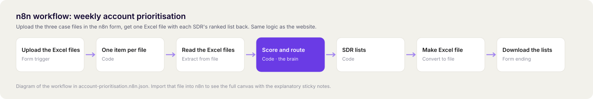

# n8n workflow

The same cleaning, scoring and routing as the website, as an n8n automation.

**How it runs:** upload the three case files (accounts, signals, sdrs) in the n8n form, and the workflow returns one Excel file with each SDR's ranked list. An optional fourth file, `settings.xlsx`, overrides the leadership settings.

## Import it
1. In n8n (cloud or self-hosted, tested on n8n 2.8.4): **Create Workflow → ⋯ → Import from File** → `emnify-prioritisation.n8n.json`.
2. Click **Execute workflow**, open the form and select all three Excel files at once.
3. Submit. The SDR lists download as `sdr_lists_week_of_<date>.xlsx`.

No credentials or external services are needed. The sticky notes on the canvas explain why each step works the way it does.

## Nodes
| Node | What it does |
|---|---|
| Upload the Excel files | n8n form with a multi-file upload |
| One item per file | Splits the upload so each file is read on its own |
| Read the Excel files | Turns each spreadsheet into rows |
| Score and route | Recognises the files by their columns, cleans, scores and routes (same logic as `../logic.js`) |
| SDR lists | One row per assigned account |
| Make Excel file | Builds the Excel file |
| Download the lists | Returns the file to the browser |
